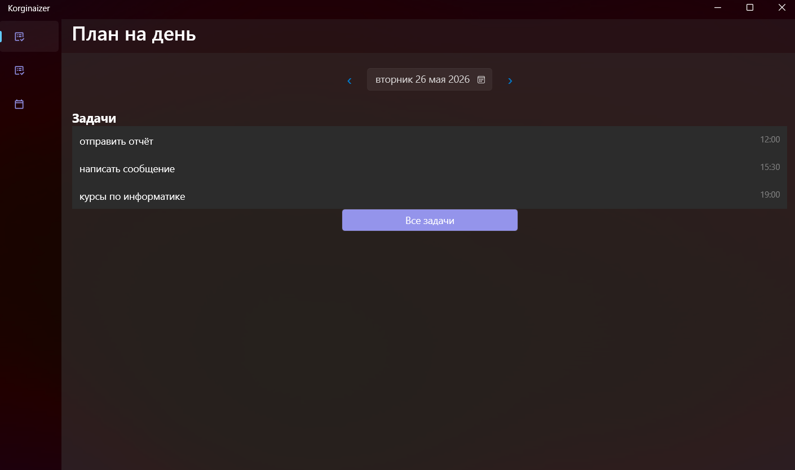
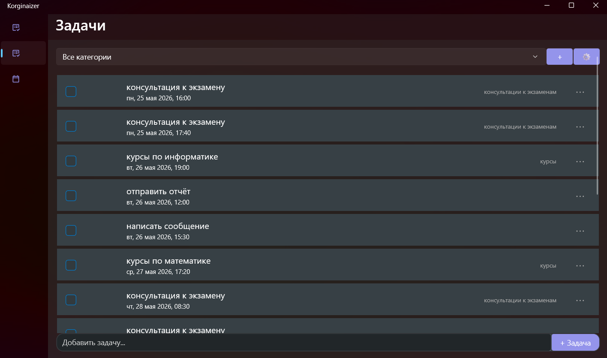
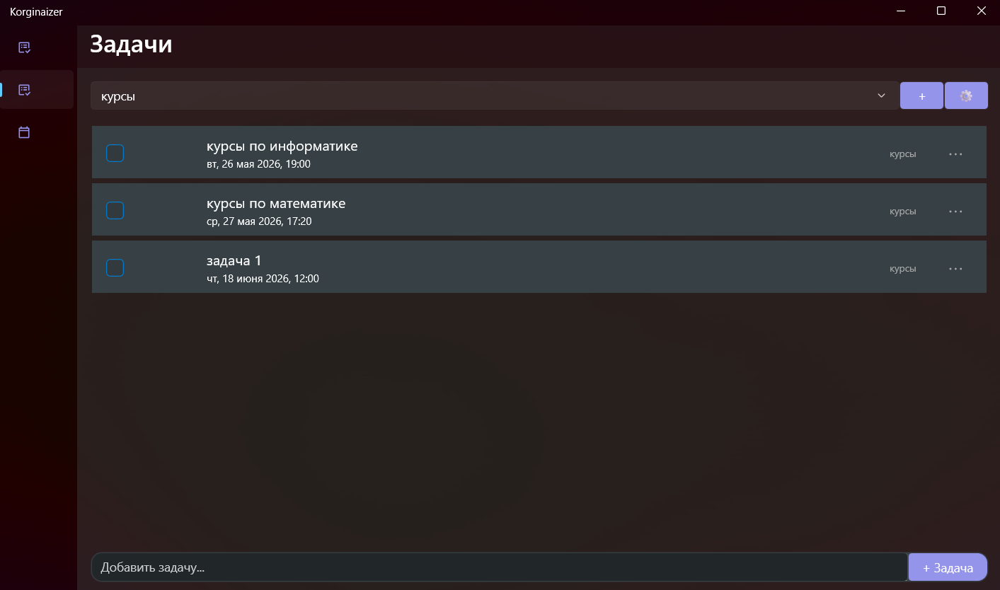
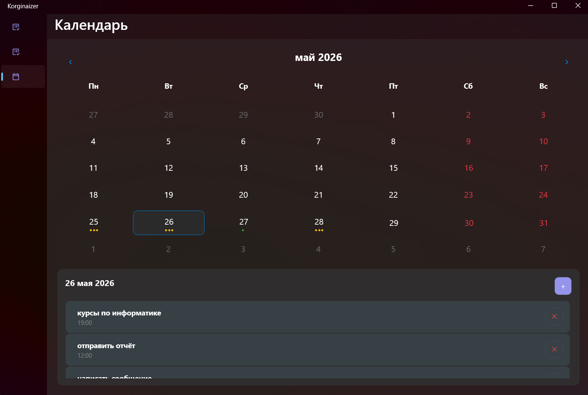
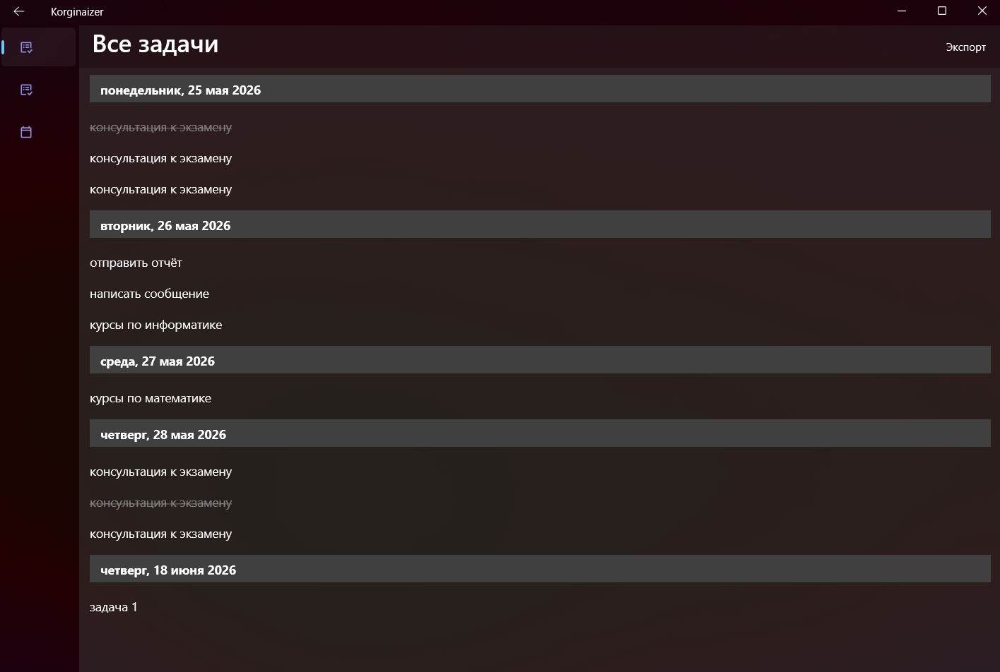
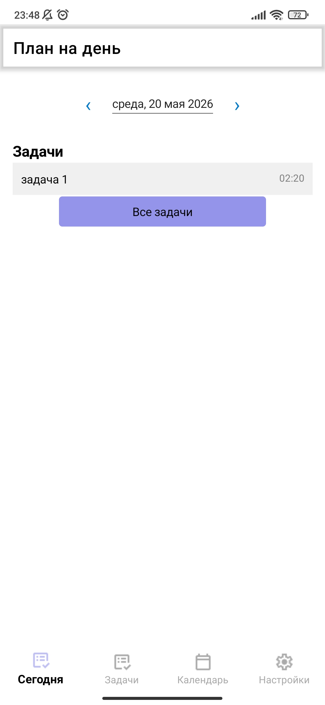
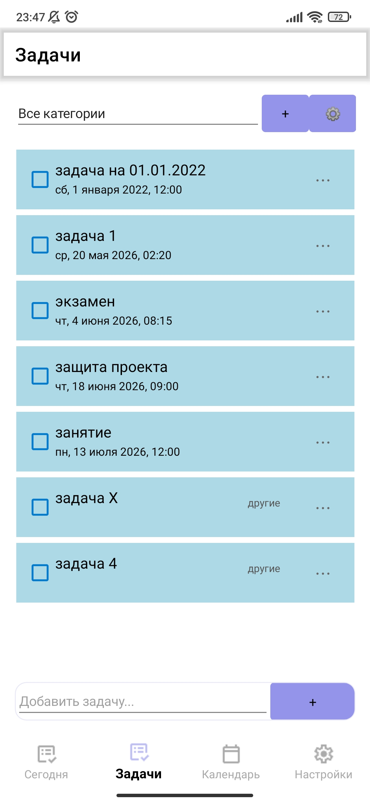
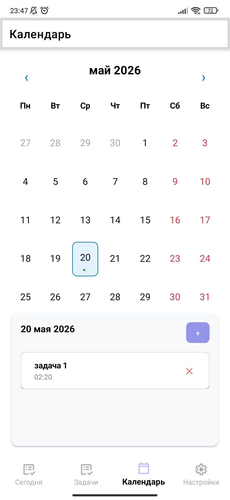

# Korginaizer

**Korginaizer** — это кроссплатформенное приложение (органайзер/координатор задач), разработанное в качестве выпускной квалификационной работы (дипломного проекта). Приложение предназначено для эффективного планирования времени, управления задачами и повышения личной продуктивности.

Благодаря использованию фреймворка **.NET MAUI**, приложение имеет единую кодовую базу и работает как на мобильных устройствах (**Android**), так и на десктопах (**Windows**).

---

## Основные возможности (Функционал)
* **Менеджер задач:** Создание, редактирование и удаление повседневных задач.
* **Календарь/Планировщик:** Визуальное отображение планов на неделю/месяц.
* **Уведомления:** Локальные пуши для напоминания о созданных событиях (на Android).
* **Категории и теги:** Группировка задач по проектам или приоритетам.
* **Кроссплатформенность:** Адаптивный UI интерфейс, подстраивающийся под экраны смартфонов и ПК.
* **Экспорт календаря** Возможность экспортировать задачи в файл .ics и перенести их в другое приложение.

---

## Технологический стек
* **Фреймворк:** .NET MAUI (.NET 9.0)
* **Язык программирования:** C# 13
* **Разметка интерфейса:** XAML
* **Архитектурный паттерн:** MVVM (Model-View-ViewModel)
* **База данных:** SQLite (с использованием SQLite-net-pcl для локального хранения данных)
* **Инструменты:** Visual Studio 2022, .NET MAUI Workloads, Android SDK.

---

## Структура проекта
```
Korginaizer/
│
├── Korginaizer.sln         # Файл решения (Solution)
└── MauiApp1/               # Основной проект .NET MAUI
    ├── Platforms/          # Платформозависимый код (Android, Windows и др.)
    ├── Resources/          # Ресурсы приложения (Иконки, Шрифты, Стили, Splash-скрины)
    ├── Models/             # Модели данных
    ├── ViewModels/         # Логика представления (MVVM)
    ├── Views/              # Страницы интерфейса (XAML + Code-behind)
    ├── Services/           # Сервисы (работа с БД, API, навигация)
    └── App.xaml            # Главный конфигурационный файл приложения
```

---

## Запуск и развертывание

### Требования к среде разработки
1. Установленная **Visual Studio 2022** (версии 17.14.21 или новее).
2. Рабочая нагрузка (Workload) **Разработка под мобильные устройства .NET** (включает .NET MAUI).
3. Для Android: установленный Android SDK и настроенный эмулятор (или физическое устройство с включенной отладкой по USB).

### Клонирование и запуск
1. Склонируйте репозиторий:
   ```bash
   git clone https://github.com/yanvarevvolodya/Korginaizer
   ```
2. Откройте файл решения `Korginaizer.sln` в Visual Studio.
3. Дождитесь восстановления (Restore) всех NuGet-пакетов.
4. Выберите целевую платформу в верхней панели Visual Studio:
   * Для Windows: Выберите `Компьютер Windows (Windows Machine)`.
   * Для Android: Выберите ваш эмулятор или подключенное Android-устройство.
5. Нажмите **F5** (или кнопку Start) для сборки и запуска приложения.

### Используемые библиотеки (NuGet-пакеты)
* sqlite-net-pcl (1.9.172)
* Plugin.LocalNotification (11.1.4)
* Microsoft.Toolkit.Uwp.Notifications (7.1.3)
* Ical.Net (4.2.0)
* CommunityToolkit.Maui (12.0.0)

### Скриншоты
## **Windows**
* Главный экран (TodayPage)

* Задачи (TasksPage)


* Календарь (CalendarPage)

* Список всех задач (на главном экране)

## **Android**
* Главный экран (TodayPage)

* Задачи (TasksPage)

* Календарь (CalendarPage)
